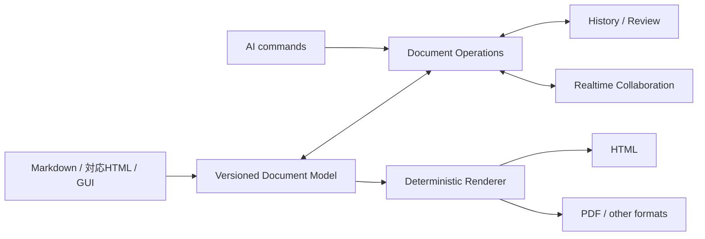

# Nexus Kajiya

> 知識をつなぎ、人とAIで価値ある成果物へ鍛え、次の世代へつなぐ。

Nexus Kajiyaは、LLMが生成したMarkdownやHTMLスライドを、人がブラウザ上で仕上げられるようにするところから始める、AIネイティブな成果物編集基盤です。

現在は、**構造化JSONを正本として1枚のHTMLスライドを編集するv0.1 MVP**です。完成した共同編集サービスではなく、今後の中核となる文書モデル・Renderer・編集操作の分離を検証しています。

## なぜ作るのか

LLMによって、Markdown、HTML、プレゼンテーションなどの最初の成果物は短時間で生成できるようになりました。一方、生成後の制作にはまだ次の課題があります。

- 小さな修正でも、プロンプトによる再生成が必要になる
- 再生成すると、人が加えた調整や意図が失われやすい
- HTMLやCSSを直接編集するには専門知識が必要になる
- GUI、コード、AIによる変更が、同じ履歴として残らない
- 議論や知識が、再利用できる組織の成果物へ育たない

Nexus Kajiyaは、AIにすべてを再生成させるのではなく、**AIが作った最初の90%を、人とAIが安全に磨き上げる制作環境**を目指します。

## 名前に込めた意味

- **Nexus** — 人、AI、知識、成果物が交わる結節点
- **Kajiya（鍛冶屋）** — 素材を繰り返し鍛え、長く使える道具へ変える職人

知識を集めるだけでなく、共同で磨き、会社にとって価値ある成果物にし、その背景とともに未来へ残す。そのための「知識の鍛冶場」がNexus Kajiyaです。

## プロダクトの焦点

長期的には、スライドに限らず、技術文書、分析レポート、手順書、ダッシュボードなどを扱える成果物編集基盤を構想しています。

ただし、当面は対象を次に絞ります。

> **LLMが生成したMarkdownまたは所定形式のデータからHTMLスライドを作り、人がGUIで修正し、再利用可能な形式で保存・出力する。**

最初から任意のHTMLやPowerPointとの完全な互換性を目指すのではなく、制約されたスライドモデルで「生成後の編集」を確実に良くすることを優先します。

## 設計方針

### 1. HTMLではなく、構造化文書を正本にする

HTML文字列を直接共同編集すると、要素の削除と内容の変更が競合したときに構造が壊れやすくなります。そこで、バージョン付きのDocument Modelを唯一のデータソースとし、HTMLはそこから生成される出力として扱います。

### 2. すべての変更を同じ操作として扱う

GUI操作、Markdownの取り込み、AI編集、将来の共同編集は、Document Modelに対する小さな操作へ変換します。これにより、Undo、差分表示、レビュー、監査履歴を同じ仕組みで実現できるようにします。

### 3. Rendererを編集UIから分離する

同じ入力から同じ表示・出力が得られる決定的なRendererを維持します。編集用の選択枠や入力欄はRendererの外側に重ね、成果物へ混入させません。

### 4. 正しさ、表現力、AI、共同編集の順に積み上げる

共同編集やAIを先に追加しても、文書モデルと基本操作が不安定であれば変更を安全にマージできません。まず単独ユーザーで壊れずに編集・保存・復元できることを固め、その後にAIと複数人の操作を接続します。

## 目指すアーキテクチャ



Markdown、GUI、AI、共同編集のどこから変更しても、中心にあるDocument Modelへ同じルールで反映される構造を目指します。

## 現在のMVP — v0.1

現在実装されている機能は次のとおりです。

- 960 × 540の単一スライド
- `title` / `body`テキスト要素の表示
- テキスト要素のドラッグ移動
- ダブルクリックによるインライン編集
- ZodによるDocument Modelの検証
- JSONファイルの読み込み・保存
- 表示専用Rendererと編集オーバーレイの分離
- Dockerによる開発・本番ビルド

サンプルデータは[`samples/sample-slide-document.json`](samples/sample-slide-document.json)にあります。

### 現在の操作

- テキストをドラッグして移動
- テキストをダブルクリックして編集
- `Ctrl + Enter`、macOSでは `⌘ + Enter`、またはフォーカスを外して確定
- `Esc`で編集をキャンセル
- `JSONを保存`で現在のDocument Modelをダウンロード
- `JSONを読み込む`で保存済みの状態を復元

### まだできないこと

- 複数スライド
- 要素の追加・削除・リサイズ
- 画像、図形、表、グラフ
- Markdownの取り込み
- 編集済みHTMLのダウンロード
- Undo / Redo、変更履歴、コメント
- AIによる自然言語編集
- 複数人でのリアルタイム共同編集
- PDF / PPTX出力

## Roadmap

バージョン番号は目安です。機能数ではなく、各段階で検証したいプロダクト仮説を基準に進めます。

| Phase | テーマ | 主な成果 |
| --- | --- | --- |
| **v0.1 — Core Prototype** | 文書モデルと編集方式の検証 | 単一スライド、テキスト編集・移動、JSON入出力、Renderer分離 |
| **v0.2 — Reliable Editor** | 単独ユーザーで壊れずに編集できる | 複数スライド、要素操作、リサイズ、スタイル編集、Undo / Redo、自動保存、スキーマ移行、テスト |
| **v0.3 — Markdown to Artifact** | LLM出力を実用的な成果物へ変換する | Markdown取り込み、テーマとレイアウト、画像、静的HTML出力、再読み込み |
| **v0.4 — AI Editing** | AIの変更を安全・可逆にする | 選択範囲への自然言語編集、構造化Patch、変更プレビュー、適用・却下、操作履歴 |
| **v0.5 — Collaboration** | 人と人、人とAIが同じ成果物を編集する | 共有ドキュメント、Presence、リアルタイム同期、コメント、競合処理、権限の最小構成 |
| **v1.0 — Knowledge Lifecycle** | 成果物を組織の資産として残す | バージョン、レビュー・承認、出典と作成意図、テンプレート、検索・再利用、外部連携 |

### 次のマイルストーン: v0.2

次に優先するのは、AIや共同編集ではなく、編集の土台です。

1. Document Modelを複数スライド・複数要素へ拡張する
2. すべての変更をCommandとして表現し、Undo / Redoを実装する
3. 選択、移動、リサイズ、追加、削除、スタイル変更を一貫したUIで扱う
4. ローカル自動保存とスキーマ移行を追加する
5. Document OperationsとRendererの自動テストを整備する

v0.2の完了条件は、**ブラウザだけで複数枚の資料を作成・編集し、閉じてから復元しても同じ状態と見た目を再現できること**です。

## 現時点での非目標

スコープを保つため、少なくともv0.xでは次を目標にしません。

- 任意の既存Webサイトを、そのJavaScriptを含めて完全に取り込む
- PowerPointやFigmaの全機能を再実装する
- 任意のHTMLを往復変換して、元のコードを完全に保持する
- 独自のLLMそのものを開発する
- スライド編集と同時に、汎用的な社内WikiやRAG基盤を完成させる

対応HTMLを取り込む場合も、編集可能な要素とCSSを定義したサポート対象形式から段階的に進めます。

## 技術構成

- React 19
- TypeScript
- Vite
- Zod
- Docker / Nginx

主なファイル:

- [`src/model/slideSchema.ts`](src/model/slideSchema.ts) — バージョン付きDocument Modelのスキーマ
- [`src/model/documentOperations.ts`](src/model/documentOperations.ts) — 文書を不変更新する操作
- [`src/components/SlideRenderer.tsx`](src/components/SlideRenderer.tsx) — 表示専用Renderer
- [`src/components/SlideEditor.tsx`](src/components/SlideEditor.tsx) — ドラッグとテキスト編集のUI

## 開発を始める

### Docker Compose

```bash
docker compose up --build
```

ブラウザで`http://localhost:5173`を開きます。

### ローカル

Node.js 22を推奨します。

```bash
npm install
npm run dev
```

### 本番用コンテナ

```bash
docker build --target production \
  -t nexus-kajiya:latest \
  -f docker/Dockerfile .

docker run --rm -p 8080:80 nexus-kajiya:latest
```

ブラウザで`http://localhost:8080`を開きます。

### ビルド

```bash
npm run build
```

## 判断基準

今後の機能は、次の問いに「はい」と答えられるかで優先順位を決めます。

1. LLM生成後の手直しを、再生成より速く安全にできるか
2. 人の変更や意図を失わず、後から確認・取り消しできるか
3. 特定のAIや出力形式に閉じず、構造化データとして再利用できるか
4. 単発のデモではなく、実際の資料作成で繰り返し使えるか
5. 将来、複数人とAIの操作を同じ履歴へ統合できるか

---

**Connecting knowledge. Forging legacy.**
