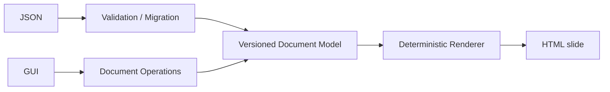

# Nexus Kajiya

> 知識をつなぎ、人とAIで価値ある成果物へ鍛え、次の世代へつなぐ。

## プロジェクト概要

Nexus Kajiyaは、LLMが生成したMarkdownやHTMLスライドを、人がブラウザ上で仕上げられるようにするところから始める、AIネイティブな成果物編集基盤です。

LLMが作った最初の90%をすべて再生成するのではなく、人とAIが変更内容を安全に積み重ね、再利用できる成果物へ磨き上げる環境を目指しています。

背景には、小さな修正でも再生成が必要になり、人が加えた調整や意図が失われやすいという課題があります。GUI、コード、AIによる変更を同じ履歴として扱い、議論や知識を組織で再利用できる成果物へ育てることが長期的な狙いです。

名前は、人・AI・知識・成果物が交わる結節点を表す**Nexus**と、素材を繰り返し鍛えて長く使える道具へ変える**Kajiya（鍛冶屋）**に由来します。

現在は、**構造化JSONを正本としてHTMLスライドを編集するv0.1 MVP**です。完成した共同編集サービスではなく、今後の中核となるDocument Model、文書操作、Renderer、編集UIの分離を検証しています。

> 当面の対象は、LLMが生成したMarkdownまたは所定形式のデータからHTMLスライドを作り、人がGUIで修正し、再利用可能な形式で保存・出力することです。

### 現在できること

- 960 × 540のスライドを表示
- `title` / `body`テキストをドラッグして移動
- ダブルクリックでテキストをインライン編集
- 複数スライド・任意数要素と文中の書式を表現できるDocument Model v3
- ZodによるJSON検証と、v1 / v2からv3への自動マイグレーション
- JSONファイルの読み込みと保存
- 静的HTMLの対応部分を編集可能なテキストへ変換し、プレビュー後に取り込み
- 複数スライドの切り替えと編集
- 表示専用Rendererと編集オーバーレイの分離

画面上部のページボタンで、文書内の各スライドを切り替えて編集できます。サンプルデータは[`samples/sample-slide-document.json`](samples/sample-slide-document.json)にあります。

### 現在の操作

- ドラッグ: テキストを移動
- ダブルクリック: テキストを編集
- `Ctrl + Enter`（macOSでは`⌘ + Enter`）またはフォーカスを外す: 編集を確定
- `Esc`: 編集をキャンセル
- `JSONを保存`: 現在のDocument Modelをダウンロード
- `JSONを読み込む`: 保存済みの状態を復元
- `HTMLを読み込む`: 変換後の全ページと警告を確認し、「この内容で取り込む」で現在の文書を置き換え

HTMLはUTF-8の単一ファイルが対象です。`data-nexus-slide`または`.slide`をスライド単位として扱い、指定がなければ本文全体を1枚として扱います。スライドは16:9にしてください。画像・表・SVG・複雑な装飾・JavaScriptによる動的表示は対象外で、外部ファイルも取得しません。元HTMLのローカルフォント指定、太さ、字間、行間、文中の色分け・改行を保持します。外部フォントや図形・背景装飾の完全再現には対応していません。以前の取り込みで失われた書式は、元HTMLから取り込み直してください。

[HTMLサンプル](samples/sample-slides.html)と[詳しい対応範囲](docs/html-import-plan.md)を参照してください。取り込みを確定する前に、編集中の文書を必要に応じてJSONで保存してください。

## セットアップ

### Docker Compose

```bash
docker compose up --build
```

ブラウザで`http://localhost:5173`を開きます。依存パッケージを追加した後に既存コンテナを使う場合は、`docker compose exec app npm ci`と`docker compose restart app`で反映します。

### ローカル開発

Node.js 22を推奨します。

```bash
npm install
npm run dev
```

### テストとビルド

```bash
npm test
npm run build
# インストール済みのGoogle Chromeでブラウザテスト
npm run test:e2e
```

### 本番用コンテナ

```bash
docker build --target production \
  -t nexus-kajiya:latest \
  -f docker/Dockerfile .

docker run --rm -p 8080:80 nexus-kajiya:latest
```

ブラウザで`http://localhost:8080`を開きます。

## ディレクトリ構成

```text
.
├── docker/                   # 開発・本番コンテナの定義
├── docs/
│   └── architecture.md       # アーキテクチャの詳細
├── samples/                  # 読み込み可能なサンプルJSON
├── src/
│   ├── components/
│   │   ├── SlideEditor.tsx   # 編集操作と編集用オーバーレイ
│   │   └── SlideRenderer.tsx # Document Modelの表示
│   ├── model/
│   │   ├── slideSchema.ts    # スキーマ、検証、マイグレーション
│   │   ├── slideTemplate.ts  # テンプレート固有の制約
│   │   └── documentOperations.ts # 文書の不変更新操作
│   ├── App.tsx               # 文書状態とJSON入出力
│   └── main.tsx              # Reactエントリーポイント
├── compose.yaml
├── package.json
└── vite.config.ts
```

## アーキテクチャ概要



HTMLを直接編集せず、バージョン付きDocument Modelを唯一のデータソースとして扱います。GUIからの変更は文書操作を通じてモデルへ反映し、Rendererはモデルから表示を生成します。

システム構成、データフロー、モジュール境界、技術選定、今後の拡張方針は[`docs/architecture.md`](docs/architecture.md)を参照してください。

---

**Connecting knowledge. Forging legacy.**
