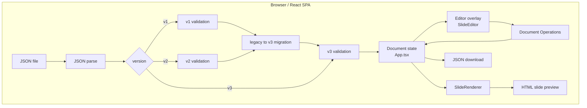
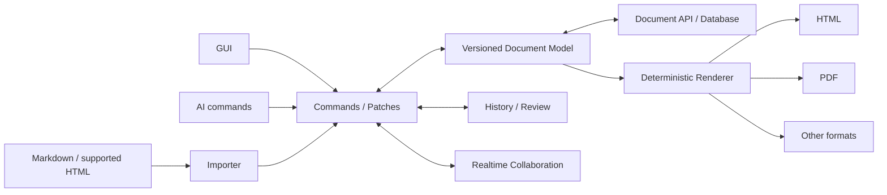
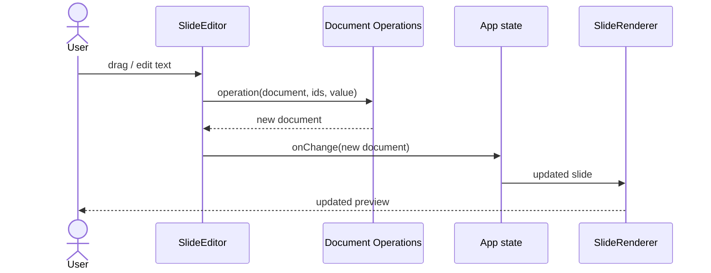

# Nexus Kajiya アーキテクチャ

## 1. 目的とスコープ

Nexus Kajiyaは、LLMが生成した成果物を、人とAIが安全に編集し、変更の意図や履歴を保ったまま再利用できる形へ育てるための編集基盤です。

現在のv0.1は、構造化JSONを正本としてHTMLスライドを編集するクライアントサイドMVPです。この文書では、現在実装されている構成と将来構想を区別して記載します。

- **現在**: Reactアプリ内でDocument Modelを保持し、テキストの移動・編集、JSON入出力を行う
- **将来**: Markdown、AI編集、変更履歴、共同編集、永続化、複数形式への出力を同じDocument Modelへ接続する

## 2. 設計原則

### 2.1 構造化文書を正本にする

HTML文字列を直接編集せず、バージョン付きDocument Modelを唯一のデータソースとします。HTMLは保存対象ではなく、モデルから生成される表示・出力です。

これにより、要素の削除と内容変更のような競合でHTML構造が壊れることを避け、検証、移行、差分、再出力をデータ構造に対して行えます。

### 2.2 変更を文書操作へ集約する

GUI、Markdown取り込み、AI編集、将来の共同編集から発生する変更は、Document Modelに対する小さな操作へ変換します。

現在は`moveTextElement`と`updateTextElement`を実装しています。将来は操作をCommandまたはPatchとして明示し、Undo / Redo、差分表示、レビュー、監査履歴の共通単位にします。

### 2.3 Rendererと編集UIを分離する

RendererはDocument Modelを表示へ変換することだけを担当します。選択枠、ヒット領域、入力欄などの編集UIは別レイヤーとして重ね、成果物の表示や出力へ混入させません。

### 2.4 正しさから段階的に積み上げる

実装順序は、文書モデルと基本操作、単独ユーザー向け編集、AI編集、共同編集、知識資産化の順とします。AIや共同編集の前に、保存・復元後も同じ状態と見た目を再現できる土台を固めます。

## 3. システム構成

### 3.1 現在の構成

現在はバックエンドを持たないブラウザ完結型のSPAです。文書状態はReactのメモリ上にあり、永続化はユーザーがダウンロード・アップロードするJSONファイルで行います。



主要な責務は次のとおりです。

| レイヤー | モジュール | 責務 |
| --- | --- | --- |
| Application | `src/App.tsx` | Document Modelの状態管理、JSONの読み込み・保存、エラー表示 |
| Editing UI | `src/components/SlideEditor.tsx` | 選択、ドラッグ、インライン編集、座標変換 |
| Rendering | `src/components/SlideRenderer.tsx` | Slideから表示専用HTMLを決定的に生成 |
| Domain operations | `src/model/documentOperations.ts` | Document Modelを破壊せずに更新 |
| Schema / migration | `src/model/slideSchema.ts` | 型、実行時検証、文書バージョン、v1 / v2からv3への移行 |
| Template rules | `src/model/slideTemplate.ts` | `title` / `body`などテンプレート固有の制約を文書スキーマから分離 |

### 3.2 目標構成



入力経路や出力形式が増えても、Document Modelと文書操作を中心に据えます。個別機能が互いの内部表現へ直接依存しない構成を維持します。

## 4. データフロー

### 4.1 起動と通常編集

1. `App`が初期Document ModelをReact stateとして保持する
2. `SlideRenderer`が選択中のSlideを表示する
3. `SlideEditor`がRendererの上に編集用オーバーレイを配置する
4. ドラッグまたはテキスト確定時に、EditorがDocument Operationを呼ぶ
5. Operationが新しいDocument Modelを返し、`App`のstateを更新する
6. 更新後のモデルを使ってRendererと編集用オーバーレイを再描画する



Document Operationsは入力モデルを直接変更しません。対象が見つからない、または対象型が一致しない場合は元の参照を返し、変更があった場合だけ更新した階層の新しいオブジェクトを返します。

### 4.2 JSON読み込み

1. ブラウザのFile APIでJSONファイルを読み込む
2. `JSON.parse`で構文を解析する
3. 宣言された`version`を確認する
4. v1 / v2なら各バージョンのスキーマで検証した後、v3へ移行する
5. v3スキーマで、型、ID一意性、要素境界などを検証する
6. 成功時だけDocument stateを置き換え、失敗時は既存状態を維持してエラーを表示する

### 4.3 JSON保存

1. 現在のDocument Modelを整形済みJSONへ変換する
2. Blobと一時URLを生成する
3. `slide-document.json`としてダウンロードする
4. 使用後の一時URLを解放する

現時点では自動保存やサーバー永続化を行いません。ブラウザを閉じる前にJSONを保存する必要があります。

## 5. Document Model

Document Model v3の概略は次のとおりです。

```text
SlideDocument
├── kind: "nexus-kajiya.slide-document"
├── version: 3
└── slides[]
    ├── id
    ├── width: 960
    ├── height: 540
    ├── background
    └── elements[]
        └── TextElement
            ├── id / type / role?
            ├── text
            ├── x / y / width / height
            └── style
```

主な不変条件は次のとおりです。

- `kind`と`version`で形式を識別できる
- 1つ以上のスライドを持つ
- スライドIDと要素IDは文書全体で一意である
- スライドは960 × 540である
- 要素はスライド領域からはみ出さない
- 色、文字サイズ、ウェイト、行間、配置は定義済みの範囲に収まる
- `title` / `body`の必須条件は文書全体の制約ではなく、テンプレートの制約として扱う

v3ではTextElementにruns（文中の書式と改行）、verticalAlignを追加し、フォント・太さ・字間・行間も保持します。従来のv1 / v2はlegacySlideSchema.tsの変更前スキーマで検証してから移行します。従来要素の縦中央揃えは維持し、HTML由来の要素は実際の文字位置に合わせて上端揃えで描画します。

要素型は`type`によるdiscriminated unionです。画像、図形、表などは新しい要素スキーマをunionへ追加し、利用側が`type`ごとに分岐する形で拡張します。

## 6. API・DB・モジュールの関係

### 6.1 現在

v0.1には外部API、アプリケーションサーバー、DBはありません。

| 境界 | 現在の状態 | データ |
| --- | --- | --- |
| Browser ↔ File system | File APIによる手動入出力 | バージョン付きDocument Model JSON |
| Editor ↔ Domain | TypeScript関数呼び出し | IDs、変更値、更新前後のDocument Model |
| Domain ↔ Renderer | React props | 検証済みSlide |
| Browser ↔ API | 未実装 | 将来のDocument / Command / Export API |
| API ↔ DB | 未実装 | 将来の文書、版、操作履歴、コメント、権限 |

依存方向は次のルールを基本とします。

- UIはDocument Operationsとスキーマの公開型に依存してよい
- Document OperationsはReactやブラウザAPIに依存しない
- Rendererは編集状態や保存方法に依存しない
- テンプレート固有のルールをDocument Modelの必須条件にしない
- 将来のAPI / DBはDocument Modelの所有者ではなく、検証済みモデルと操作履歴の永続化境界とする

### 6.2 将来のAPI / DB境界

バックエンド追加時は、最初から巨大な汎用APIにせず、次の境界を段階的に導入します。

| 境界 | 想定する責務 |
| --- | --- |
| Document API | 文書の作成、取得、保存、版管理、楽観的競合検出 |
| Command / Patch API | GUI・AI・共同編集からの構造化された変更の検証と適用 |
| Export API | 同一モデルからHTML、PDFなどを再現可能に生成 |
| Collaboration service | Presence、リアルタイム同期、競合処理 |
| Database | 文書スナップショット、操作履歴、コメント、権限、出典の永続化 |

APIへ渡す文書にも`kind`と`version`を含め、読み込み時に必ず検証・移行します。DBの内部形式をフロントエンドの一時的なUI状態へ直接結び付けない方針です。

## 7. 技術選定理由

| 技術 | 採用理由 |
| --- | --- |
| React 19 | Document stateからRendererと編集UIを宣言的に同期でき、コンポーネント境界を分けやすい |
| TypeScript | Document Model、要素型、操作の入出力を静的に検査し、要素型追加時の修正箇所を把握しやすい |
| Zod | 外部JSONはTypeScriptの型だけでは保証できないため、実行時検証と型推論を同じ定義から行う |
| Vite | MVPに必要なReact / TypeScript開発環境と本番ビルドを小さい構成で用意できる |
| Vitest | Vite / TypeScriptとの親和性が高く、スキーマと純粋なDocument Operationsを高速に検証できる |
| Docker / Nginx | Node.js 22の開発環境を揃え、本番では静的SPAを小さい実行環境で配信できる |
| 構造化JSON | 人が確認・保存でき、バージョン管理、検証、移行、AIによる構造化変更へつなげやすい |

現時点でバックエンドや状態管理ライブラリを採用していないのは、単一画面のMVPではReact stateとファイル入出力で設計仮説を検証できるためです。自動保存、複数画面、非同期同期が必要になった段階で導入を判断します。

## 8. 今後の拡張方針

### v0.2 — Reliable Editor

単独ユーザーが壊さずに編集・保存・復元できる状態を完成させます。

- 複数スライドの追加、選択、並べ替え
- 要素の追加、削除、リサイズ、スタイル編集
- すべての変更のCommand化とUndo / Redo
- ローカル自動保存
- Document OperationsとRendererのテスト拡充

完了条件は、ブラウザだけで複数枚の資料を作成・編集し、閉じてから復元しても同じ状態と見た目を再現できることです。

### v0.3 — Markdown to Artifact

- Markdown取り込み
- テーマとレイアウト
- 画像要素
- 静的HTML出力と再読み込み

### v0.4 — AI Editing

- 選択範囲への自然言語編集
- 構造化Patch
- 変更プレビューと適用・却下
- 操作履歴

AIにはモデル全体の自由な再生成ではなく、検証可能なCommand / Patchを生成させます。

### v0.5 — Collaboration

- 共有ドキュメント
- Presenceとリアルタイム同期
- コメント
- 競合処理
- 最小限の権限管理

### v1.0 — Knowledge Lifecycle

- バージョン、レビュー、承認
- 出典と作成意図の保持
- テンプレート
- 検索と再利用
- 外部サービス連携

長期的にはスライドに限らず、技術文書、分析レポート、手順書、ダッシュボードを同じ考え方で扱います。ただし、文書種別ごとのモデルとRendererを定義し、任意のHTMLを無制約に取り込む設計にはしません。

## 9. 非目標

少なくともv0.xでは、次を目標にしません。

- 任意の既存WebサイトをJavaScriptごと完全に取り込む
- PowerPointやFigmaの全機能を再実装する
- 任意のHTMLを往復変換し、元のコードを完全に保持する
- 独自のLLMそのものを開発する
- スライド編集と同時に汎用的な社内WikiやRAG基盤を完成させる

対応HTMLを取り込む場合も、編集可能な要素とCSSを定義したサポート対象形式から段階的に進めます。

HTML読み込みの追加実装は[HTML読み込みの実装方針](html-import-plan.md)に従います。初版は静的HTMLの対応部分をDocument Model v3へ変換し、変換後のプレビューと警告を確認してから編集文書へ取り込みます。初版は実装済みで、複数スライドの選択と編集にも対応します。

## 10. 設計判断の基準

機能や技術は、次の問いに「はい」と答えられるかで優先順位を決めます。

1. LLM生成後の手直しを、再生成より速く安全にできるか
2. 人の変更や意図を失わず、後から確認・取り消しできるか
3. 特定のAIや出力形式に閉じず、構造化データとして再利用できるか
4. 単発のデモではなく、実際の資料作成で繰り返し使えるか
5. 将来、複数人とAIの操作を同じ履歴へ統合できるか
